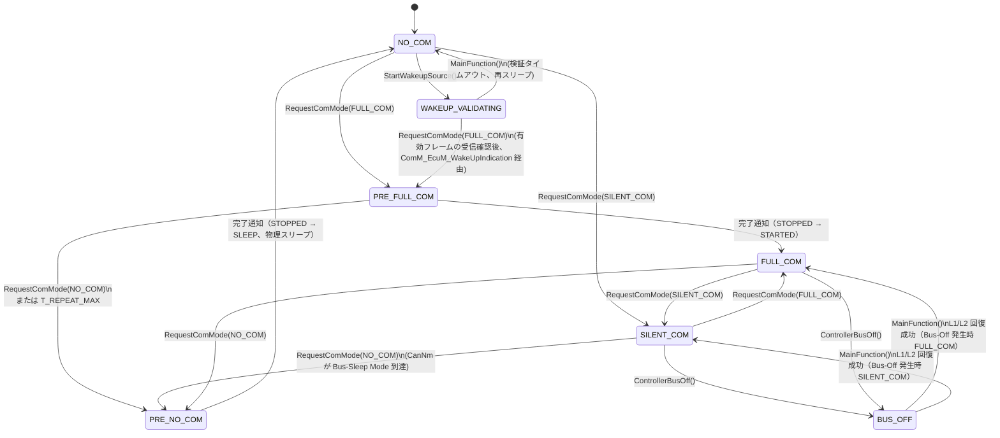

# CanSM

> [CAN 通信スタック 詳細](../can_stack.md) の「[CAN 通信状態管理](../can_stack.md#can-comm-management)」節から分離
> （旧「ECU 管理層」節から移動。実 AUTOSAR では EcuM/BswM/WdgM とは別クラスタ
> [Communication Services] に属するため）。

Bus-Off 検出直後（回復試行の前）に `ComM_BusSM_ModeIndication(SILENT_COMMUNICATION)` を
呼び、ComM のチャネル状態が回復完了まで FULL_COM のまま古い情報として残ることを
防ぐ（SWS_CanSM_00521。SILENT_COM は EcuM の RUN を維持するため回復中も RUN は
落ちない）。受け付ける Bus-Off はコントローラが物理的に稼働中の状態（FULL_COM、
および PDU の TX 抑制だけでコントローラは `CAN_CS_STARTED` のままの SILENT_COM）
のみで、回復シーケンスは L1/L2 バックオフ（SWS_CanSM_00514/00515 準拠）で実施し、
試行回数が `CANSM_BUSOFF_L1_TO_L2_COUNT` を超えるまでは短い周期（L1）でリトライし、
超えたら Dem へ DTC を報告（limit=1 のため即座に確定）した上で長い周期（L2）へ
切り替えて無期限にリトライを継続する（回復を諦めて停止する状態は存在しない）。
再起動に成功しても、その時点では回復は確定しない。確定条件（G_BUS_OFF_PASSIVE、SWS_CanSM_00496〜00498）を
満たしたとき、はじめて Dem へ PASSED を報告し、試行回数を 0 に戻す（下の「Bus-Off 回復の確定」参照）。
再起動試行に成功したら、Bus-Off 発生直前の状態（FULL_COM か SILENT_COM か）へ
復帰させる（`CanSM_PreBusOffState`、SILENT_COM だった場合は誤って FULL_COM へ
戻さない）。ComM の NO_COM 要求によるボランタリスリープでは即座にはスリープせず、
CanNm（CanNm 状態機械）が Prepare Bus-Sleep Mode へ入ると ComM 経由で SILENT_COM
（TX 停止）へ移り、Bus-Sleep Mode へ到達した通知（`Nm_BusSleepMode()` →
`ComM_Nm_BusSleepMode()` を経て ComM が呼ぶ `CanSM_RequestComMode(NO_COM)`）を
受けてから `CanIf_SetControllerMode(CAN_CS_SLEEP)`（→ `Can_SetControllerMode(CAN_T_SLEEP)`）で
実 HW を実際にスリープさせる
（協調スリープ、詳細は [`CanNm_Notes.md`](./CanNm_Notes.md) 参照）。`CanSM_StartWakeupSource()`
による復帰経路を持ち、復帰は即座に確定せず、ウェイクアップ検証（Wakeup Validation
Protocol 相当）により有効な CAN フレーム受信を確認してから FULL_COM へ確定する。

## 状態遷移

`CanSM_InternalStateType`（`CanSM.c`）が持つ5状態と、意図された遷移を図示します
（実装上到達可能な、図にない遷移が1点あります。図の直後の注記を参照）。
`NO_COM` はコントローラが物理的にスリープ済み（または未起動）の状態で、
`SILENT_COM` はコントローラは稼働したまま PDU の TX だけを止めた状態です
（CanNm の協調スリープ中、Prepare Bus-Sleep Mode に入ってから Bus-Sleep Mode へ
到達するまでがこの状態。詳細は上記本文および [`CanNm_Notes.md`](./CanNm_Notes.md) 参照）。
`BUS_OFF` 中の `CanSM_RequestComMode()` は、要求を受け付けます（`E_OK`。[SWS_CanSM_00369]/[SWS_CanSM_00182]。
2026-11 変更。以前は `E_NOT_OK` で捨てていました）。`NO_COM` は、すぐに回復を取り消して、コントローラを
スリープさせます（`BUS_OFF` から `NO_COM` へ直接遷移します）。`FULL_COM` と `SILENT_COM` は、回復の後に戻る
状態（`CanSM_PreBusOffState`）を、要求されたモードに変えます（`SILENT_COM` への変更は、すぐに TX を止めます）。

> **図にない遷移（`WAKEUP_VALIDATING` からの `RequestComMode()`）**: `CanSM_RequestComMode()`
> 冒頭のガードは `BUS_OFF` しかチェックしておらず、`WAKEUP_VALIDATING` 中に呼ばれても
> 素通りする。`RequestComMode(FULL_COM)` は直接 `FULL_COM` へ（有効フレームの受信確認後に
> `ComM_EcuM_WakeUpIndication()` が呼ぶ場合は、これが正規の経路。受信確認を経ない呼び出しでも
> 同じ遷移になる）、`RequestComMode(NO_COM)` は `Can_SetControllerMode(CAN_T_SLEEP)`
> を呼ばないまま状態だけ `NO_COM` にしてしまい、コントローラが Listen-Only
> （`CAN_CS_STOPPED`）のまま起きた状態で残る（`NO_COM` の「物理的にスリープ済み」
> という不変条件と矛盾する）。ただし `ComM_RequestComMode()` の呼び出し元
> （`App_EngineManager.c`/`Dcm.c`）はいずれも `BswM_Cfg.h` の
> `BSWM_TASK_MASK_SHUTDOWN` により SHUTDOWN 中（`WAKEUP_VALIDATING` が
> 発生しうる唯一の期間）は駆動タスクごと無効化されるため、現状この経路は
> 実機到達不能である（2026-08 のレビューで発見。コード側のガードは、この
> 到達不能性が CanSM 自身の設計ではなく BswM 側のスケジューリングという
> 別モジュールの都合に依存しているため、あえて追加していない）。

## 遷移ごとの動作と設定値

| 遷移 | CanSM が行うこと |
|------|------------------|
| `RequestComMode(FULL_COM)` | `CanIf_SetControllerMode(STARTED)`（失敗したら状態を変えず `E_NOT_OK`）→ `CanIf_SetPduMode(ONLINE)`（ベストエフォート）→ Bus-Off リトライ回数を 0 に戻す → `ComM_BusSM_ModeIndication(FULL_COM)` |
| `RequestComMode(SILENT_COM)` | FULL_COM からのときだけ `CanIf_SetPduMode(TX_OFFLINE)`（コントローラは `CAN_CS_STARTED` のまま、PDU の送信だけを止める）→ `ComM_BusSM_ModeIndication(SILENT_COM)` |
| `RequestComMode(NO_COM)` | `CanIf_SetControllerMode(SLEEP)` → `ComM_BusSM_ModeIndication(NO_COM)` |
| `StartWakeupSource()`（ウェイクアップ。EcuM の `EcuM_CheckWakeup()` から） | NO_COM のときだけ効く。`CanIf_SetControllerMode(STOPPED)`（Listen-Only）にして `WAKEUP_VALIDATING` へ。それ以外の状態では、要求だけ受理して何もしない（`E_OK`） |
| `StopWakeupSource()` | `WAKEUP_VALIDATING` のときだけ効く。`CanIf_SetControllerMode(SLEEP)` で再スリープして NO_COM へ（検証タイムアウトと共通の処理）。EcuM は、現在この関数を呼ばない |
| `ControllerModeIndication()`（コントローラのモード変更の完了通知。Can の `Can_MainFunction_Mode()` から、CanIf 経由） | `PRE_FULL_COM` / `PRE_NO_COM` で、待っているモードへ達した通知が、手順を次へ進める。それ以外は、何もしない（下の「コントローラのモード変更の手順」参照） |
| `RequestComMode(FULL_COM)`（検証中に有効フレームを確認した後、`ComM_EcuM_WakeUpIndication()` から） | `CanIf_SetControllerMode(STARTED)` → PDU を ONLINE → `ComM_BusSM_ModeIndication(FULL_COM)` |
| `MainFunction()`（検証タイムアウト） | `CanIf_SetControllerMode(SLEEP)` で再スリープ（ウェイクアップ割り込みを再武装）し NO_COM へ戻る |

`CanSM_MainFunction()` は Os Task 4（10ms 周期）です。設定値（`CanSM_Cfg.h`）:

| 定数 | 既定値 | 意味 |
|------|--------|------|
| `CANSM_BUSOFF_RECOVERY_L1_MS` | 200 ms | Bus-Off 回復リトライの間隔（L1） |
| `CANSM_BUSOFF_RECOVERY_L2_MS` | 5000 ms | L2 の間隔（L1 を使い切った後） |
| `CANSM_BUSOFF_L1_TO_L2_COUNT` | 3 回 | L1 のリトライ回数。超えると L2 へ（`DemConf_DemEventParameter_CAN_BUSOFF` のデバウンス閾値は、この値 + 1。Bus-Off の検出ごとの PREFAILED が、この回数に達すると DTC が確定する） |
| `CANSM_BOR_TX_CONFIRMATION_POLLING` | 1 | 回復の確定に TX 確認のポーリングを使う（1）か、時間で判定する（0）か |
| `CANSM_BOR_TIME_TX_ENSURED_MS` | 1000 ms | 回復の確定までの待ち時間。ポーリングを使わない（上が 0 の）とき、および SILENT_COM に戻った場合に使う |
| `CANSM_WAKEUP_VALIDATION_MS` | 2000 ms | ウェイクアップ検証の待ち時間。この間に有効な RX が無ければ再スリープ |

### コントローラのモード変更の手順（S_PRE_FULLCOM / S_PRE_NOCOM、2026-11）

FULL_COM へ入る、または NO_COM へ入るとき、CanSM は、コントローラのモードを変える要求を出し、その**完了通知を待って**から
次へ進みます（仕様の `CANSM_BSM_S_PRE_FULLCOM` / `CANSM_BSM_S_PRE_NOCOM`）。通知は、Can の `Can_MainFunction_Mode()`
（1 ms の Os タスク）が `CanIf_ControllerModeIndication()` へ出し、CanIf が `CanSM_ControllerModeIndication()` へ渡します。

| 手順 | 順序 | 完了したとき |
|---|---|---|
| `PRE_FULL_COM`（NO_COM、WAKEUP_VALIDATING から FULL_COM へ） | STOPPED → STARTED（現在が STOPPED なら、STOPPED は省く） | PDU を ONLINE にして FULL_COM へ入り、ComM へ FULL_COM を通知 |
| `PRE_NO_COM`（FULL_COM、SILENT_COM、BUS_OFF、WAKEUP_VALIDATING から NO_COM へ） | STOPPED → SLEEP（現在が STOPPED なら、STOPPED は省く） | NO_COM へ入り、ComM へ NO_COM を通知 |

- 待っているモードへ達した通知だけが、手順を進めます（待っていないモードの通知は、無視します）。
- `CANSM_MODEREQ_REPEAT_TIME_MS`（300 ms）が過ぎても通知が来なければ、同じ要求を繰り返します。繰り返しが
  `CANSM_MODEREQ_REPEAT_MAX`（3 回）を超えたら T_REPEAT_MAX です。`PRE_FULL_COM` からは `PRE_NO_COM` へ戻り、
  `PRE_NO_COM` からは、あきらめて NO_COM へ入ります。T_REPEAT_MAX のたびに、Dem へ `CANSM_MODE_REQUEST_TIMEOUT`
  （DTC 0x000110、[SWS_CanSM_00385]/[00664]）を PREFAILED で報告し、FULL_COM へ入る手順が最後の完了通知（STARTED）まで届いたときに、PREPASSED で戻します
  （途中の通知や、NO_COM へ入る手順の通知では戻しません。PREFAILED を直後に打ち消さないため）。
  デバウンスのしきい値は 2 です（2 回の失敗で確定）。
- `PRE_NO_COM` の最中に FULL_COM が要求されたら、保留して、NO_COM へ入り終えたあとで、始めます。
  `PRE_FULL_COM` の最中に NO_COM が要求されたら、`PRE_NO_COM` へ向きを変えます。
- SILENT_COM から FULL_COM へ戻るときは、コントローラが既に STARTED のため、この手順を経ずに、PDU を ONLINE にするだけです。
- `RequestComMode()` は、要求を受理した時点で `E_OK` を返します。ComM への通知は、手順が完了したとき（1〜数 ms 後）に出ます。
- Bus-Off の回復と、起床の検証（`WAKEUP_VALIDATING` の出入り）は、まだ、この待ちの仕組みに載せていません（同期のまま）。

### Bus-Off 回復の確定（G_BUS_OFF_PASSIVE、2026-10 追加）

再起動（`CanIf_SetControllerMode(STARTED)`）に成功した時点では、回復は確定しません（以前は、再起動できた
直後に Dem へ PASSED を報告していました）。次の条件を満たしたとき、回復が確定します。

| 設定 | 確定条件 |
| --- | --- |
| `CANSM_BOR_TX_CONFIRMATION_POLLING` = 1（既定、[SWS_CanSM_00497]） | 再起動後に `CanIf_GetTxConfirmationState()` が `CANIF_TX_RX_NOTIFICATION`（TX 確認が 1 回でもあった）を返す |
| 0（[SWS_CanSM_00496]）、または SILENT_COM に戻った場合 | 再起動から `CANSM_BOR_TIME_TX_ENSURED_MS` 以上経過した（SILENT_COM は CanIf 層で TX を抑制しており、TX 確認が得られないため） |

確定したとき（[SWS_CanSM_00498]）、Dem へ `DEM_EVENT_STATUS_PASSED` を報告し、回復試行回数を 0 に戻します。
確定する前に再度 Bus-Off が起きると、確定しないまま次の回復試行へ進み、回数は持ち越されます
（[SWS_CanSM_00514]/[00515] の回数は「G_BUS_OFF_PASSIVE を通らずに繰り返した回数」）。
そのため、単発の Bus-Off が、起動後に累積して、突然 L2（長い間隔）や DTC の確定になることはなくなりました。
Bus-Off を検出するたびに、Dem へ `DEM_EVENT_STATUS_PREFAILED` を報告します（[SWS_CanSM_00522]/[00605]）。
Dem のデバウンスカウンタが閾値（`CANSM_BUSOFF_L1_TO_L2_COUNT` + 1）に達した瞬間に DTC が確定し、
確定（G_BUS_OFF_PASSIVE）の PASSED でカウンタが戻ります。FULL_COM へ入っただけでは PASSED を報告しません
（以前は報告していた。仕様は E_BUS_OFF_PASSIVE のときだけ）。
逆に、TX 確認が一度も得られない状況（他のノードが ACK を返さないなど）では、確定せず、回数は増え続け、
L1 を使い切ると L2 になり、DTC も確定します。TX 確認の状態は、コントローラを起動し直すたびに CanIf が
リセットする（[SWS_CANIF_00734]）ので、回復の再起動より前の確認は数えません。
`RequestComMode(FULL_COM)`（新しく FULL_COM に入り直す）は、確定待ちを破棄して、回数を 0 に戻します。

## 開発の経緯（実機で見つかった不具合・設計変更）

> 現在の仕様を理解するだけなら読む必要はありません。実機検証で見つかった
> 不具合や、その結果としての設計変更の経緯を時系列でまとめています。

### Bus-Off 回復断念設計の撤去

以前は Bus-Off の回復リトライを一定回数（既定 3 回）で断念し、専用の恒久
スリープ（AUTOSAR 標準外の `Can_EnterFinalSleep()`）へ落とす設計だった。
外部レビューで AUTOSAR 仕様（SWS_CanSM_00514/00515/00636）を確認したところ、
「回復を諦めて二度と復帰しない」状態はそもそも仕様に存在しないことが判明した。
仕様が定めるのは L1（短い間隔）→ L2（長い間隔）の二段階バックオフのみで、
無期限にリトライを継続する設計である。

これを受けて `Can_EnterFinalSleep()` とその呼び出し経路（`Can.c`/`Can.h`/
`Can_Hw.h`/`Can_Hw.cpp` の `CAN_HW_MODE_SLEEP_FINAL` を含む）を全て撤去し、
`CANSM_BUSOFF_RECOVERY_L1_MS`/`_L2_MS`/`CANSM_BUSOFF_L1_TO_L2_COUNT` による
L1/L2 バックオフに置き換えた。あわせて Bus-Off 検出直後（回復試行の前）に
`ComM_BusSM_ModeIndication(SILENT_COMMUNICATION)` を呼ぶようにし（SWS_CanSM_00521）、
ComM のチャネル状態が回復完了まで FULL_COM のまま古い情報として残ることを
防いだ。

この設計変更は EcuM 側にも影響した。EcuM に「同一ユーザからの重複 RUN 要求」
検知（SWS_EcuM_04125/04127）を追加したところ、CanSM の Bus-Off L1/L2
バックオフがリトライ成功のたびに `ComM_BusSM_ModeIndication(FULL_COM)` を呼ぶ
（RUN を解放していないため）ことと衝突し、重複要求ログが頻発する状態に
なった。これを避けるため `ComM_BusSM_ModeIndication()` はチャネルモードが実際に
変化した時のみ `EcuM_RequestRUN()`/`EcuM_ReleaseRUN()` を呼ぶよう修正した。

（can_stack.md 該当箇所: [CAN コントローラの実スリープ](../can_stack.md#can-コントローラの実スリープcan_setcontrollermodecan_t_sleep)）

### NO_COM_PENDING_SLEEP 中の Bus-Off 見逃し

> **後日談（2026-08〜09）**: 本節で扱う `CANSM_STATE_NO_COM_PENDING_SLEEP` は、その後
> ComM が CanNm の協調スリープ完了（`ComM_Nm_BusSleepMode()`）を待ってから初めて
> `CanSM_RequestComMode(NO_COM)` を呼ぶ設計へ変わったため削除された。現在は FULL_COM から
> 物理スリープまで一気に遷移し、受け付ける Bus-Off は FULL_COM と SILENT_COM、
> 回復時の復元は `CanSM_PreBusOffState` が担う。以下は当時の経緯の記録。

AUTOSAR 仕様書（SWS_CanSM）とのスペック監査で、`CanSM_ControllerBusOff()` が
`CANSM_STATE_FULL_COM` からの Bus-Off しか受け付けていないことが判明した。
CanNm 協調スリープ導入時に追加された `CANSM_STATE_NO_COM_PENDING_SLEEP`（「もう
通信は不要だが CanNm が Bus-Sleep Mode へ到達するまでコントローラは稼働継続」する
状態）は、コントローラが物理的に稼働中でありうる点で FULL_COM と同じなのに、
このガードの対象に含まれていなかった。この状態中に実際に Bus-Off が発生すると、
回復シーケンスが一切起動しないまま HW が Bus-Off し続ける不具合だった。

単純にガードを緩めるだけでは別の不具合を誘発することも判明した。Bus-Off 回復
（`CanSM_MainFunction()`）は無条件に `CANSM_STATE_FULL_COM` へ復帰させる実装
だったため、NO_COM_PENDING_SLEEP 中に発生した Bus-Off から回復すると「もう
通信不要」だった意図を上書きしてしまい、誰も再要求しないため二度と NO_COM
（ボランタリスリープ）へ戻れず FULL_COM に取り残される。これを避けるため、
Bus-Off 発生時点の状態を `CanSM_BusOffFromPendingSleep` フラグで記憶し、回復後
も元の意図（FULL_COM か NO_COM_PENDING_SLEEP か）を復元するようにした。

この修正の検証中、`ComM_BusSM_ModeIndication()` の重複呼び出し防止ロジック
（`Mode != prevMode` 判定）にも別の潜在バグが見つかった。Bus-Off 検出時に
一時的に挟まる `COMM_SILENT_COMMUNICATION`（EcuM の RUN 状態には無関係）を
経由すると、回復時の FULL_COM/NO_COM 通知が「SILENT_COM からの変化」として
見えてしまい、`EcuM_RequestRUN()`/`EcuM_ReleaseRUN()` が不要に再度呼ばれ、
`ECUM_E_MULTIPLE_RUN_REQUESTS`/`ECUM_E_MISMATCHED_RUN_RELEASE` を誤検知する
（FULL_COM 経由でも元々存在した不具合で、今回の修正は NO_COM_PENDING_SLEEP
側にも同じクラスの問題を広げただけだった）。`ComM_EcuMRunMode` という専用の
内部状態（EcuM へ最後に伝えた FULL/NO_COM の別。SILENT_COM では更新しない）
で判定するよう修正し、あわせて解消した。

さらに、`CanSM_ControllerBusOff()` のガードが `CANSM_STATE_SILENT_COM` を
「コントローラは必ず停止済み」という前提で除外していたが、`CanSM_RequestComMode()`
の SILENT_COMMUNICATION 分岐は元々 `CANSM_STATE_FULL_COM` からの遷移でしか
コントローラを停止していなかった。NO_COM_PENDING_SLEEP から SILENT_COM への
遷移が公開 API `ComM_RequestComMode()` 経由で到達可能な経路として残っていたため、
この分岐も NO_COM_PENDING_SLEEP を含むよう修正し、不変条件を実際に成立させた
（現状のアプリケーションコードはこの経路を使わないため潜在バグの段階だった）。

**実機検証の顛末**: NO_COM_PENDING_SLEEP 中の Bus-Off パスは、狙って実機で
直接再現させるのが難しかった。CAN-USB アダプタを物理的に外して相手ノードを
完全に消しても Bus-Off が発生しなかった理由は、`CanNm_MainFunction()` の
`CANNM_STATE_READY_SLEEP` ケース（`CanNm.c`）が送信を一切行わない設計（ログの
"Ready Sleep State (tx stopped)" の通り）であり、かつ Com の TX I-PDU
グループも `Com_IpduGroupStop()` で停止済みのため、NO_COM_PENDING_SLEEP から
実際のスリープまでの数秒間はほぼ何も送信されないためだった。TX 連続失敗を
トリガとする Bus-Off（一次検出の EFLG.TXBO も、送信しなければ TEC が上がら
ないため同様）は、この区間内では構造的にほぼ発生しえない。最終的に、
FULL_COM 経路（相手ノード不在による自然発生 Bus-Off、実機で 10 回以上反復
実証済み。EcuM 側の DET 誤検知なしも確認）と同一のコードパスを通ることに
よる間接的な検証と、コードレビューをもって十分と判断した。

（can_stack.md 該当箇所: [CAN 通信状態管理（ComM / CanSM / CanNm）](../can_stack.md#can-comm-management)）
